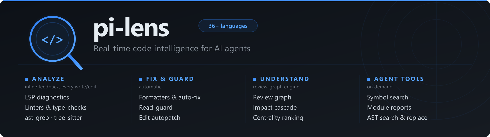

<p align="center">
  
</p>

# pi-lens

[](https://omppackages.com/packages/pi-lens)

pi-lens gives AI coding agents fast, language-aware feedback while they write and edit code. It is an extension for the pi coding agent, with an experimental [MCP server](docs/mcp.md) for other hosts.

> **An AI agent working with pi-lens?** Read the [agent guide](docs/agent-guide.md). It explains the findings you will see and how to respond.
>
> **An AI agent changing pi-lens itself?** Read [`AGENTS.md`](AGENTS.md) and [`CONTRIBUTING.md`](CONTRIBUTING.md). A one-line-per-doc index for agents is in [`llms.txt`](llms.txt).

## Quick start

```bash
pi install npm:pi-lens
```

Or from git: `pi install git:github.com/apmantza/pi-lens`.

Requirements: Node.js >=22.19.0 and a pi host of 0.86.1 or newer. On pi 0.80–0.85, pi-lens gives no findings, because those hosts keep the prompt where the extension cannot write to it. [Release QA baseline](docs/release-qa-baseline.md) lists the certified hosts. See [Troubleshooting](#troubleshooting) for npm v12, Android, and skills-manifest notes.

Install it and start a session. The language servers and many linters start with no setup. Some tools need your project's config, and a few are opt-in. See [What runs by default](#what-runs-by-default) and [Settings](docs/settings.md).

To let a coding agent install it, paste this into its prompt:

```text
Install pi-lens (npm:pi-lens) into pi, then read docs/agent-guide.md in
https://github.com/apmantza/pi-lens for how to read and respond to its findings.
```

## What the agent sees

After an edit, the tool result carries any blocking findings, with the offending line. At the end of the turn, pi-lens injects the findings that remain. The text below follows the real renderers: the `STOP` block from `clients/pipeline.ts`, and the turn-end framing, `Advisory` label, and warnings summary from `clients/runtime-context.ts` and `clients/runtime-turn.ts`.

```text
🔴 STOP — 1 issue(s) must be fixed:
  L4: 'randomInt' is declared but its value is never read.
      → const randomInt = Math.floor(result);

[pi-lens automated check — not a user request] Address 🔴 blockers before continuing; ℹ️ advisories are informational only.

ℹ️ Advisory — no action required this turn:
🟡 Fixable warnings introduced this turn: 1.
Use lens_diagnostics with mode=delta to inspect these warnings.
Files:
  src/app.ts: 1
```

The agent must clear a 🔴 blocker before it reports the task as done. A result marked partial, stale, or unconfirmed is never reported as clean.

## What you get

- **Real diagnostics on every edit.** Language servers, linters, type-checkers, and scanners check each written file, and an impact cascade checks the files that depend on it. See [language coverage](docs/language-coverage.md).
- **Safe formatting and autofix.** pi-lens formats and fixes files with the tools you configure or it confidently detects.
- **Structural rules.** ast-grep and tree-sitter rules flag correctness and security smells, and you can add [custom rules](docs/custom-rules.md).
- **Code navigation for the agent.** Tools cover LSP navigation, ranked identifier search, module reports, and symbol reads, so the agent reads less code. See [agent tools](docs/agent-tools.md).
- **Guards and triage.** Read-before-edit blocks blind edits, an optional git guard holds `git commit` while blockers stand, and on pi you can mark a finding false-positive, suppressed, or deferred. The marking tool has no MCP endpoint, and under pi's lazy tool loading the agent activates it first. See [dispositions](docs/dispositions.md) and [agent tools](docs/agent-tools.md).
- **Health and scans.** `/lens-health` reports runtime health, and opted-in projects get background security and dependency scans.

The [feature reference](docs/features.md) covers everything.

## What runs by default

pi-lens runs tools in three tiers. The [per-tool table](docs/language-coverage.md#what-runs-by-default) lists every gate and where it lives in the code.

- **No project config.** Language servers start by default, and `--no-lsp` turns them off. Many linters and formatters also run when the tool is available. Examples: ruff, shellcheck, hadolint, and ktlint for linting; oxlint or Biome for JS and TS when the project has no ESLint config; Biome and shfmt for formatting.
- **Your project's config.** ESLint, golangci-lint, mypy, phpstan, and vale skip a project that lacks their config. detekt needs a detekt config file, credo needs `mix.exs`, and the taplo and clang-format formatters wait for config.
- **Opt-in.** trivy (`trivy.enabled`), SpotBugs (`--lens-spotbugs`), Helm render validation (`helm.renderValidation.enabled`), and the commit guard (`--lens-guard`) stay off until you enable them.

Project-local binaries, such as `node_modules/.bin/eslint` or `.venv/bin/ruff`, run only when pi trusts the project.

## Commands you'll use

| Command | What it does |
|---|---|
| `/lens-health` | Show runtime health, latency, and degradation counts |
| `/lens-widget-toggle` | Show or hide the diagnostics widget below the editor |
| `/lens-toggle` | Turn pi-lens on or off for the session |
| `/lens-map` | Build an interactive HTML dependency map of the project |
| `/lens-allow-edit <path>` | Override the read-before-edit guard for one edit |
| `/lens-tools` | Show which tools are installed, auto-installed, or fall back to `npx` |

The full list of commands and runtime flags is in [Tools and commands](docs/tools.md).

## Documentation

### Use

- [Agent guide](docs/agent-guide.md): how an agent reads and responds to pi-lens
- [Agent tools](docs/agent-tools.md): tool names, scopes, and arguments
- [Usage guide](docs/usage.md): lifecycle, tool behavior, MCP notes, and troubleshooting
- [Features](docs/features.md): the detailed feature reference
- [Diagnostic dispositions](docs/dispositions.md): triage with false-positive, suppress, defer, and flagged-to-fix
- [Word index](docs/word-index.md): identifier search and the discovery funnel

### Configure

- [Settings](docs/settings.md): defaults, environment variables, flags, and global versus project config
- [Configuration](docs/globalconfig.md): global and project config files
- [Environment variables](docs/environment-variables.md): the full reference
- [Language coverage](docs/language-coverage.md): supported languages, runners, and formatters
- [Dependencies](docs/dependencies.md): auto-install policy and external tools

### Extend

- [Custom rules](docs/custom-rules.md): project ast-grep and tree-sitter rules
- [MCP server](docs/mcp.md): the experimental server for Claude Code and other MCP clients
- [Architecture](docs/architecture.md): how events reach the findings the agent sees
- [Architecture decision records](docs/adr/README.md): settled design decisions

## Troubleshooting

<details>
<summary>Install problems</summary>

The install notes in the [usage guide](docs/usage.md#install-notes) cover three cases:

- **npm v12** asks you to approve dependency install scripts such as the `@ast-grep/cli` postinstall.
- **Android and Termux** can fail to find the `@ast-grep/cli` native binary. The notes give a verified fallback.
- **Skills** arrive through the package manifest. Loading the extension file directly (`pi --extension ./index.js`) loads no pi-lens skills.

</details>

For runtime problems, run `/lens-health` and read the [usage guide troubleshooting section](docs/usage.md#troubleshooting).

## Contributing

See [`CONTRIBUTING.md`](CONTRIBUTING.md) for the development workflow, runner, LSP, formatter, and rule checklists, and for issue and PR conventions.

Report security issues privately; see [`SECURITY.md`](SECURITY.md).
pi-lens is released under the [MIT License](LICENSE).

## Contributors

Thanks goes to these wonderful people:
<!-- ALL-CONTRIBUTORS-LIST:START - Do not remove or modify this section -->
<!-- prettier-ignore-start -->
<!-- markdownlint-disable -->
<table>
  <tbody>
    <tr>
      <td align="center" valign="top" width="14.28%"><a href="https://github.com/apmantza"><br /><sub><b>Apostolos Mantzaris</b></sub></a><br /><a href="#code-apmantza" title="Code">💻</a> <a href="#doc-apmantza" title="Documentation">📖</a> <a href="#ideas-apmantza" title="Ideas & Planning">🤔</a> <a href="#maintenance-apmantza" title="Maintenance">🚧</a> <a href="#review-apmantza" title="Reviewed Pull Requests">👀</a></td>
      <td align="center" valign="top" width="14.28%"><a href="https://github.com/AngriestBird"><br /><sub><b>Kenneth McCormick</b></sub></a><br /><a href="#bug-AngriestBird" title="Bug reports">🐛</a> <a href="#code-AngriestBird" title="Code">💻</a> <a href="#ideas-AngriestBird" title="Ideas & Planning">🤔</a> <a href="#doc-AngriestBird" title="Documentation">📖</a> <a href="https://github.com/apmantza/pi-lens/commits?author=AngriestBird" title="Tests">⚠️</a></td>
      <td align="center" valign="top" width="14.28%"><a href="https://github.com/anh-chu"><br /><sub><b>Anh Chu</b></sub></a><br /><a href="#code-anh-chu" title="Code">💻</a></td>
      <td align="center" valign="top" width="14.28%"><a href="https://github.com/loss-and-quick"><br /><sub><b>minicx</b></sub></a><br /><a href="#code-loss-and-quick" title="Code">💻</a></td>
      <td align="center" valign="top" width="14.28%"><a href="https://github.com/silvanshade"><br /><sub><b>silvanshade</b></sub></a><br /><a href="#code-silvanshade" title="Code">💻</a></td>
      <td align="center" valign="top" width="14.28%"><a href="https://github.com/tifandotme"><br /><sub><b>Tifan Dwi Avianto</b></sub></a><br /><a href="#code-tifandotme" title="Code">💻</a></td>
      <td align="center" valign="top" width="14.28%"><a href="https://github.com/amit-gshe"><br /><sub><b>Amit</b></sub></a><br /><a href="#code-amit-gshe" title="Code">💻</a> <a href="#bug-amit-gshe" title="Bug reports">🐛</a></td>
    </tr>
    <tr>
      <td align="center" valign="top" width="14.28%"><a href="https://github.com/fractiunate"><br /><sub><b>Fractiunate // David Rahäuser</b></sub></a><br /><a href="#code-fractiunate" title="Code">💻</a></td>
      <td align="center" valign="top" width="14.28%"><a href="https://github.com/vkarasen"><br /><sub><b>Vitali Karasenko</b></sub></a><br /><a href="#code-vkarasen" title="Code">💻</a> <a href="#ideas-vkarasen" title="Ideas & Planning">🤔</a></td>
      <td align="center" valign="top" width="14.28%"><a href="https://github.com/rfxlamia"><br /><sub><b>V</b></sub></a><br /><a href="#code-rfxlamia" title="Code">💻</a></td>
      <td align="center" valign="top" width="14.28%"><a href="https://github.com/fabio-dee"><br /><sub><b>Fabio Dee</b></sub></a><br /><a href="#code-fabio-dee" title="Code">💻</a></td>
      <td align="center" valign="top" width="14.28%"><a href="https://github.com/moj02090"><br /><sub><b>moj02090</b></sub></a><br /><a href="#code-moj02090" title="Code">💻</a></td>
      <td align="center" valign="top" width="14.28%"><a href="https://github.com/mehalter"><br /><sub><b>Micah Halter</b></sub></a><br /><a href="#code-mehalter" title="Code">💻</a></td>
      <td align="center" valign="top" width="14.28%"><a href="https://github.com/JulienEllie"><br /><sub><b>Julien Ellie</b></sub></a><br /><a href="#code-JulienEllie" title="Code">💻</a></td>
    </tr>
    <tr>
      <td align="center" valign="top" width="14.28%"><a href="https://github.com/Istar-Eldritch"><br /><sub><b>Ruben Paz</b></sub></a><br /><a href="#code-Istar-Eldritch" title="Code">💻</a> <a href="#bug-Istar-Eldritch" title="Bug reports">🐛</a></td>
      <td align="center" valign="top" width="14.28%"><a href="https://github.com/cjunxiang"><br /><sub><b>C.Junxiang</b></sub></a><br /><a href="#code-cjunxiang" title="Code">💻</a> <a href="#bug-cjunxiang" title="Bug reports">🐛</a></td>
      <td align="center" valign="top" width="14.28%"><a href="https://github.com/trvon"><br /><sub><b>Trevon</b></sub></a><br /><a href="#code-trvon" title="Code">💻</a></td>
      <td align="center" valign="top" width="14.28%"><a href="https://github.com/cmptr"><br /><sub><b>Aaron Bell</b></sub></a><br /><a href="#code-cmptr" title="Code">💻</a> <a href="#bug-cmptr" title="Bug reports">🐛</a></td>
      <td align="center" valign="top" width="14.28%"><a href="https://github.com/StartupBros"><br /><sub><b>Will Mitchell</b></sub></a><br /><a href="#code-StartupBros" title="Code">💻</a></td>
      <td align="center" valign="top" width="14.28%"><a href="https://github.com/spyrosbazios"><br /><sub><b>spyrosbazios</b></sub></a><br /><a href="#code-spyrosbazios" title="Code">💻</a></td>
      <td align="center" valign="top" width="14.28%"><a href="https://github.com/Roman-Galeev"><br /><sub><b>Roman Galeev</b></sub></a><br /><a href="#code-Roman-Galeev" title="Code">💻</a></td>
    </tr>
    <tr>
      <td align="center" valign="top" width="14.28%"><a href="https://github.com/jerryfan"><br /><sub><b>jerryfan</b></sub></a><br /><a href="#code-jerryfan" title="Code">💻</a></td>
      <td align="center" valign="top" width="14.28%"><a href="https://github.com/shaDmx"><br /><sub><b>Max L.</b></sub></a><br /><a href="#code-shaDmx" title="Code">💻</a></td>
      <td align="center" valign="top" width="14.28%"><a href="https://github.com/radge"><br /><sub><b>David Ryan</b></sub></a><br /><a href="#code-radge" title="Code">💻</a></td>
      <td align="center" valign="top" width="14.28%"><a href="https://github.com/JayceFreeman"><br /><sub><b>JayceFreeman</b></sub></a><br /><a href="#code-JayceFreeman" title="Code">💻</a></td>
      <td align="center" valign="top" width="14.28%"><a href="https://github.com/bloodf"><br /><sub><b>Heitor Ramon Ribeiro</b></sub></a><br /><a href="#code-bloodf" title="Code">💻</a></td>
      <td align="center" valign="top" width="14.28%"><a href="https://github.com/feoh"><br /><sub><b>Chris Patti</b></sub></a><br /><a href="#code-feoh" title="Code">💻</a> <a href="#bug-feoh" title="Bug reports">🐛</a></td>
      <td align="center" valign="top" width="14.28%"><a href="https://github.com/chenxin-yan"><br /><sub><b>Chenxin Yan</b></sub></a><br /><a href="#code-chenxin-yan" title="Code">💻</a> <a href="#doc-chenxin-yan" title="Documentation">📖</a> <a href="#bug-chenxin-yan" title="Bug reports">🐛</a></td>
    </tr>
    <tr>
      <td align="center" valign="top" width="14.28%"><a href="https://github.com/flowing-abyss"><br /><sub><b>flowing-abyss</b></sub></a><br /><a href="#code-flowing-abyss" title="Code">💻</a></td>
      <td align="center" valign="top" width="14.28%"><a href="https://github.com/shaochong-theoai"><br /><sub><b>shaochong-theoai</b></sub></a><br /><a href="#code-shaochong-theoai" title="Code">💻</a> <a href="#ideas-shaochong-theoai" title="Ideas & Planning">🤔</a></td>
      <td align="center" valign="top" width="14.28%"><a href="https://github.com/xuli500177"><br /><sub><b>Xu Yili</b></sub></a><br /><a href="#bug-xuli500177" title="Bug reports">🐛</a> <a href="#code-xuli500177" title="Code">💻</a></td>
      <td align="center" valign="top" width="14.28%"><a href="https://github.com/ricardoraposo"><br /><sub><b>Ricardo Raposo</b></sub></a><br /><a href="#code-ricardoraposo" title="Code">💻</a></td>
      <td align="center" valign="top" width="14.28%"><a href="https://github.com/jsmestad"><br /><sub><b>Justin Smestad</b></sub></a><br /><a href="#code-jsmestad" title="Code">💻</a> <a href="#ideas-jsmestad" title="Ideas & Planning">🤔</a></td>
      <td align="center" valign="top" width="14.28%"><a href="https://github.com/anasalsbey-glitch"><br /><sub><b>anasalsbey-glitch</b></sub></a><br /><a href="#code-anasalsbey-glitch" title="Code">💻</a> <a href="#bug-anasalsbey-glitch" title="Bug reports">🐛</a></td>
      <td align="center" valign="top" width="14.28%"><a href="https://github.com/PeraSite"><br /><sub><b>정제훈</b></sub></a><br /><a href="#code-PeraSite" title="Code">💻</a> <a href="#ideas-PeraSite" title="Ideas & Planning">🤔</a></td>
    </tr>
    <tr>
      <td align="center" valign="top" width="14.28%"><a href="https://github.com/ymek"><br /><sub><b>Myke Stubbs</b></sub></a><br /><a href="#code-ymek" title="Code">💻</a> <a href="#bug-ymek" title="Bug reports">🐛</a></td>
      <td align="center" valign="top" width="14.28%"><a href="https://github.com/JSap0914"><br /><sub><b>JSap0914</b></sub></a><br /><a href="#code-JSap0914" title="Code">💻</a></td>
      <td align="center" valign="top" width="14.28%"><a href="https://github.com/knthmn"><br /><sub><b>Kent Hou Man</b></sub></a><br /><a href="#code-knthmn" title="Code">💻</a> <a href="#bug-knthmn" title="Bug reports">🐛</a></td>
      <td align="center" valign="top" width="14.28%"><a href="https://neumie.dev/"><br /><sub><b>Jakub Neumann</b></sub></a><br /><a href="#code-neumie" title="Code">💻</a> <a href="#bug-neumie" title="Bug reports">🐛</a> <a href="#ideas-neumie" title="Ideas & Planning">🤔</a></td>
      <td align="center" valign="top" width="14.28%"><a href="https://github.com/cy7372"><br /><sub><b>CyYu</b></sub></a><br /><a href="#code-cy7372" title="Code">💻</a></td>
      <td align="center" valign="top" width="14.28%"><a href="https://github.com/carolitascl"><br /><sub><b>Carolina</b></sub></a><br /><a href="#bug-carolitascl" title="Bug reports">🐛</a> <a href="#ideas-carolitascl" title="Ideas & Planning">🤔</a></td>
      <td align="center" valign="top" width="14.28%"><a href="https://github.com/leakedby"><br /><sub><b>LeakedBy</b></sub></a><br /><a href="#bug-leakedby" title="Bug reports">🐛</a></td>
    </tr>
    <tr>
      <td align="center" valign="top" width="14.28%"><a href="https://github.com/mdbooth"><br /><sub><b>Matthew Booth</b></sub></a><br /><a href="#bug-mdbooth" title="Bug reports">🐛</a></td>
      <td align="center" valign="top" width="14.28%"><a href="https://github.com/Wiedzmin89"><br /><sub><b>Wiedzmin89</b></sub></a><br /><a href="#ideas-Wiedzmin89" title="Ideas & Planning">🤔</a></td>
      <td align="center" valign="top" width="14.28%"><a href="https://github.com/grodingo"><br /><sub><b>Virgile</b></sub></a><br /><a href="#bug-grodingo" title="Bug reports">🐛</a></td>
      <td align="center" valign="top" width="14.28%"><a href="https://github.com/finnvyrn"><br /><sub><b>Finn</b></sub></a><br /><a href="#ideas-finnvyrn" title="Ideas & Planning">🤔</a></td>
      <td align="center" valign="top" width="14.28%"><a href="https://github.com/ywh555hhh"><br /><sub><b>Wayne E</b></sub></a><br /><a href="#bug-ywh555hhh" title="Bug reports">🐛</a></td>
      <td align="center" valign="top" width="14.28%"><a href="https://github.com/RimuruW"><br /><sub><b>RimuruW</b></sub></a><br /><a href="#ideas-RimuruW" title="Ideas & Planning">🤔</a></td>
      <td align="center" valign="top" width="14.28%"><a href="https://github.com/Bjynt"><br /><sub><b>Bjynt</b></sub></a><br /><a href="#bug-Bjynt" title="Bug reports">🐛</a> <a href="#ideas-Bjynt" title="Ideas & Planning">🤔</a></td>
    </tr>
    <tr>
      <td align="center" valign="top" width="14.28%"><a href="https://github.com/pvtri96"><br /><sub><b>Tri Van Pham</b></sub></a><br /><a href="#bug-pvtri96" title="Bug reports">🐛</a></td>
      <td align="center" valign="top" width="14.28%"><a href="https://github.com/BingWuJ"><br /><sub><b>BingWuJ</b></sub></a><br /><a href="#bug-BingWuJ" title="Bug reports">🐛</a></td>
      <td align="center" valign="top" width="14.28%"><a href="https://github.com/tackleberrybey"><br /><sub><b>tackleberrybey</b></sub></a><br /><a href="#bug-tackleberrybey" title="Bug reports">🐛</a></td>
      <td align="center" valign="top" width="14.28%"><a href="https://github.com/TaterDoge"><br /><sub><b>Mariann Abshire</b></sub></a><br /><a href="#bug-TaterDoge" title="Bug reports">🐛</a></td>
      <td align="center" valign="top" width="14.28%"><a href="https://github.com/ProbabilityEngineer"><br /><sub><b>ProbabilityEngineer</b></sub></a><br /><a href="#ideas-ProbabilityEngineer" title="Ideas & Planning">🤔</a></td>
      <td align="center" valign="top" width="14.28%"><a href="https://github.com/LeonardoRick"><br /><sub><b>Leonardo Rick</b></sub></a><br /><a href="#bug-LeonardoRick" title="Bug reports">🐛</a> <a href="#ideas-LeonardoRick" title="Ideas & Planning">🤔</a></td>
      <td align="center" valign="top" width="14.28%"><a href="https://github.com/kenbanks-peng"><br /><sub><b>Ken Banks</b></sub></a><br /><a href="#bug-kenbanks-peng" title="Bug reports">🐛</a></td>
    </tr>
    <tr>
      <td align="center" valign="top" width="14.28%"><a href="https://github.com/rstacruz"><br /><sub><b>Rico Sta. Cruz</b></sub></a><br /><a href="#ideas-rstacruz" title="Ideas & Planning">🤔</a></td>
      <td align="center" valign="top" width="14.28%"><a href="https://github.com/acidnik"><br /><sub><b>Nikita Bilous</b></sub></a><br /><a href="#bug-acidnik" title="Bug reports">🐛</a></td>
      <td align="center" valign="top" width="14.28%"><a href="https://github.com/av1155"><br /><sub><b>Andrea Arturo Venti Fuentes</b></sub></a><br /><a href="#bug-av1155" title="Bug reports">🐛</a></td>
      <td align="center" valign="top" width="14.28%"><a href="https://github.com/dacec354"><br /><sub><b>dacec354</b></sub></a><br /><a href="#bug-dacec354" title="Bug reports">🐛</a></td>
      <td align="center" valign="top" width="14.28%"><a href="https://github.com/nodnarbnitram"><br /><sub><b>Brandon Martin</b></sub></a><br /><a href="#bug-nodnarbnitram" title="Bug reports">🐛</a></td>
      <td align="center" valign="top" width="14.28%"><a href="https://github.com/alpertarhan"><br /><sub><b>Alper Tarhan</b></sub></a><br /><a href="#bug-alpertarhan" title="Bug reports">🐛</a></td>
      <td align="center" valign="top" width="14.28%"><a href="https://github.com/asolopovas"><br /><sub><b>Andrius Solopovas</b></sub></a><br /><a href="#bug-asolopovas" title="Bug reports">🐛</a></td>
    </tr>
    <tr>
      <td align="center" valign="top" width="14.28%"><a href="https://github.com/GrahamJenkins"><br /><sub><b>Graham Jenkins</b></sub></a><br /><a href="#bug-GrahamJenkins" title="Bug reports">🐛</a></td>
      <td align="center" valign="top" width="14.28%"><a href="https://github.com/wings1848"><br /><sub><b>Wings Butterfly</b></sub></a><br /><a href="#bug-wings1848" title="Bug reports">🐛</a></td>
      <td align="center" valign="top" width="14.28%"><a href="https://github.com/JohannesKlauss"><br /><sub><b>Johannes Klauss</b></sub></a><br /><a href="#ideas-JohannesKlauss" title="Ideas & Planning">🤔</a></td>
      <td align="center" valign="top" width="14.28%"><a href="https://github.com/tan-yong-sheng"><br /><sub><b>Tan Yong Sheng</b></sub></a><br /><a href="#ideas-tan-yong-sheng" title="Ideas & Planning">🤔</a></td>
      <td align="center" valign="top" width="14.28%"><a href="https://github.com/fmatray"><br /><sub><b>Frédéric</b></sub></a><br /><a href="#bug-fmatray" title="Bug reports">🐛</a></td>
      <td align="center" valign="top" width="14.28%"><a href="https://github.com/fuentesjr"><br /><sub><b>Salvador Fuentes Jr</b></sub></a><br /><a href="#bug-fuentesjr" title="Bug reports">🐛</a></td>
      <td align="center" valign="top" width="14.28%"><a href="https://github.com/Viterkim"><br /><sub><b>Viktor</b></sub></a><br /><a href="#bug-Viterkim" title="Bug reports">🐛</a> <a href="#ideas-Viterkim" title="Ideas & Planning">🤔</a></td>
    </tr>
    <tr>
      <td align="center" valign="top" width="14.28%"><a href="https://github.com/ortonomy"><br /><sub><b>Gregory Orton</b></sub></a><br /><a href="#bug-ortonomy" title="Bug reports">🐛</a></td>
      <td align="center" valign="top" width="14.28%"><a href="https://github.com/jimallen"><br /><sub><b>Jim Allen</b></sub></a><br /><a href="#bug-jimallen" title="Bug reports">🐛</a></td>
      <td align="center" valign="top" width="14.28%"><a href="https://github.com/quantfiction"><br /><sub><b>quantfiction</b></sub></a><br /><a href="#bug-quantfiction" title="Bug reports">🐛</a></td>
      <td align="center" valign="top" width="14.28%"><a href="https://github.com/Artawower"><br /><sub><b>Art</b></sub></a><br /><a href="#bug-Artawower" title="Bug reports">🐛</a></td>
      <td align="center" valign="top" width="14.28%"><a href="https://github.com/chozandrias76"><br /><sub><b>Colin Swenson-Healey</b></sub></a><br /><a href="#bug-chozandrias76" title="Bug reports">🐛</a></td>
      <td align="center" valign="top" width="14.28%"><a href="https://github.com/JustlyAI"><br /><sub><b>Laurent Wiesel</b></sub></a><br /><a href="#bug-JustlyAI" title="Bug reports">🐛</a></td>
      <td align="center" valign="top" width="14.28%"><a href="https://github.com/stark-bit"><br /><sub><b>Rei Starks</b></sub></a><br /><a href="#bug-stark-bit" title="Bug reports">🐛</a></td>
    </tr>
    <tr>
      <td align="center" valign="top" width="14.28%"><a href="https://github.com/robertoecf"><br /><sub><b>Roberto Freitas</b></sub></a><br /><a href="#bug-robertoecf" title="Bug reports">🐛</a></td>
      <td align="center" valign="top" width="14.28%"><a href="https://github.com/tmttodd"><br /><sub><b>tmttodd</b></sub></a><br /><a href="#bug-tmttodd" title="Bug reports">🐛</a></td>
      <td align="center" valign="top" width="14.28%"><a href="https://github.com/smaharnav"><br /><sub><b>smaharnav</b></sub></a><br /><a href="#bug-smaharnav" title="Bug reports">🐛</a></td>
      <td align="center" valign="top" width="14.28%"><a href="https://github.com/MzaGuille"><br /><sub><b>Mza.Guille</b></sub></a><br /><a href="#bug-MzaGuille" title="Bug reports">🐛</a></td>
      <td align="center" valign="top" width="14.28%"><a href="http://jasonrimmer.com/"><br /><sub><b>Jason Rimmer</b></sub></a><br /><a href="#bug-jrimmer" title="Bug reports">🐛</a></td>
      <td align="center" valign="top" width="14.28%"><a href="https://github.com/ArthurHeymans"><br /><sub><b>Arthur Heymans</b></sub></a><br /><a href="#ideas-ArthurHeymans" title="Ideas & Planning">🤔</a></td>
      <td align="center" valign="top" width="14.28%"><a href="https://github.com/Blue-B"><br /><sub><b>Blue-B</b></sub></a><br /><a href="#bug-Blue-B" title="Bug reports">🐛</a> <a href="#ideas-Blue-B" title="Ideas & Planning">🤔</a></td>
    </tr>
    <tr>
      <td align="center" valign="top" width="14.28%"><a href="https://github.com/bisko"><br /><sub><b>Biser Perchinkov</b></sub></a><br /><a href="#bug-bisko" title="Bug reports">🐛</a></td>
      <td align="center" valign="top" width="14.28%"><a href="https://github.com/xificurC"><br /><sub><b>Peter Nagy</b></sub></a><br /><a href="#bug-xificurC" title="Bug reports">🐛</a></td>
      <td align="center" valign="top" width="14.28%"><a href="https://github.com/orest-tokovenko-block"><br /><sub><b>Orest Tokovenko</b></sub></a><br /><a href="#bug-orest-tokovenko-block" title="Bug reports">🐛</a> <a href="#ideas-orest-tokovenko-block" title="Ideas & Planning">🤔</a></td>
      <td align="center" valign="top" width="14.28%"><a href="https://eisterman.dev/"><br /><sub><b>Federico Pasqua</b></sub></a><br /><a href="#bug-eisterman" title="Bug reports">🐛</a> <a href="#ideas-eisterman" title="Ideas & Planning">🤔</a></td>
      <td align="center" valign="top" width="14.28%"><a href="https://github.com/black-snow"><br /><sub><b>Ronald</b></sub></a><br /><a href="#bug-black-snow" title="Bug reports">🐛</a> <a href="#ideas-black-snow" title="Ideas & Planning">🤔</a></td>
      <td align="center" valign="top" width="14.28%"><a href="https://github.com/aaronkyriesenbach"><br /><sub><b>Aaron Ky-Riesenbach</b></sub></a><br /><a href="#bug-aaronkyriesenbach" title="Bug reports">🐛</a></td>
      <td align="center" valign="top" width="14.28%"><a href="https://github.com/LovelyLoong"><br /><sub><b>可爱的龙</b></sub></a><br /><a href="#bug-LovelyLoong" title="Bug reports">🐛</a></td>
    </tr>
    <tr>
      <td align="center" valign="top" width="14.28%"><a href="https://github.com/pppobear"><br /><sub><b>pppobear</b></sub></a><br /><a href="#bug-pppobear" title="Bug reports">🐛</a></td>
      <td align="center" valign="top" width="14.28%"><a href="https://github.com/bcachet"><br /><sub><b>Bertrand Cachet</b></sub></a><br /><a href="#code-bcachet" title="Code">💻</a> <a href="#ideas-bcachet" title="Ideas & Planning">🤔</a></td>
      <td align="center" valign="top" width="14.28%"><a href="https://github.com/EarthChen"><br /><sub><b>earthchen</b></sub></a><br /><a href="#code-EarthChen" title="Code">💻</a> <a href="#bug-EarthChen" title="Bug reports">🐛</a></td>
      <td align="center" valign="top" width="14.28%"><a href="https://github.com/Don-Yin"><br /><sub><b>Don Yin</b></sub></a><br /><a href="#code-Don-Yin" title="Code">💻</a> <a href="#bug-Don-Yin" title="Bug reports">🐛</a> <a href="#ideas-Don-Yin" title="Ideas & Planning">🤔</a> <a href="#doc-Don-Yin" title="Documentation">📖</a> <a href="https://github.com/apmantza/pi-lens/commits?author=Don-Yin" title="Tests">⚠️</a></td>
      <td align="center" valign="top" width="14.28%"><a href="https://github.com/ELA718"><br /><sub><b>ELA718</b></sub></a><br /><a href="#doc-ELA718" title="Documentation">📖</a></td>
      <td align="center" valign="top" width="14.28%"><a href="https://github.com/sujeito-operator/pilot"><br /><sub><b>Sujeito Operator</b></sub></a><br /><a href="#code-sujeito-operator" title="Code">💻</a></td>
      <td align="center" valign="top" width="14.28%"><a href="http://www.blahs.life/"><br /><sub><b>Dan Blah</b></sub></a><br /><a href="#bug-danblah" title="Bug reports">🐛</a></td>
    </tr>
    <tr>
      <td align="center" valign="top" width="14.28%"><a href="https://github.com/3choBoomer"><br /><sub><b>Nathan Cooke</b></sub></a><br /><a href="#code-3choBoomer" title="Code">💻</a></td>
      <td align="center" valign="top" width="14.28%"><a href="https://github.com/white-hat"><br /><sub><b>Eli Stark</b></sub></a><br /><a href="#code-white-hat" title="Code">💻</a> <a href="#bug-white-hat" title="Bug reports">🐛</a></td>
      <td align="center" valign="top" width="14.28%"><a href="https://marvinaziz.de/"><br /><sub><b>Marvin Aziz</b></sub></a><br /><a href="#code-marvtub" title="Code">💻</a> <a href="#bug-marvtub" title="Bug reports">🐛</a></td>
      <td align="center" valign="top" width="14.28%"><a href="https://github.com/mjfaga"><br /><sub><b>Mark</b></sub></a><br /><a href="#code-mjfaga" title="Code">💻</a></td>
      <td align="center" valign="top" width="14.28%"><a href="https://aeturnal.io/"><br /><sub><b>aeturnal</b></sub></a><br /><a href="#code-aeturnal" title="Code">💻</a> <a href="#bug-aeturnal" title="Bug reports">🐛</a></td>
      <td align="center" valign="top" width="14.28%"><a href="https://github.com/floatGray"><br /><sub><b>floatGray</b></sub></a><br /><a href="#code-floatGray" title="Code">💻</a></td>
      <td align="center" valign="top" width="14.28%"><a href="https://github.com/thomasfsteeples"><br /><sub><b>Thomas F Steeples</b></sub></a><br /><a href="#code-thomasfsteeples" title="Code">💻</a> <a href="#bug-thomasfsteeples" title="Bug reports">🐛</a></td>
    </tr>
    <tr>
      <td align="center" valign="top" width="14.28%"><a href="https://github.com/amasen02"><br /><sub><b>Ama Senevirathne</b></sub></a><br /><a href="#code-amasen02" title="Code">💻</a></td>
      <td align="center" valign="top" width="14.28%"><a href="https://github.com/AcademyKUB8"><br /><sub><b>AcademyKUB8</b></sub></a><br /><a href="#code-AcademyKUB8" title="Code">💻</a> <a href="#bug-AcademyKUB8" title="Bug reports">🐛</a></td>
      <td align="center" valign="top" width="14.28%"><a href="https://github.com/soulocker"><br /><sub><b>soulocker</b></sub></a><br /><a href="#bug-soulocker" title="Bug reports">🐛</a></td>
      <td align="center" valign="top" width="14.28%"><a href="https://github.com/sonic182"><br /><sub><b>Johanderson Mogollon</b></sub></a><br /><a href="#ideas-sonic182" title="Ideas & Planning">🤔</a> <a href="#bug-sonic182" title="Bug reports">🐛</a></td>
      <td align="center" valign="top" width="14.28%"><a href="https://github.com/kurihada"><br /><sub><b>kurihada</b></sub></a><br /><a href="#bug-kurihada" title="Bug reports">🐛</a></td>
      <td align="center" valign="top" width="14.28%"><a href="https://github.com/Giraffe224"><br /><sub><b>Giraffe224</b></sub></a><br /><a href="#bug-Giraffe224" title="Bug reports">🐛</a></td>
      <td align="center" valign="top" width="14.28%"><a href="http://www.crshman.com"><br /><sub><b>Robert Navarro</b></sub></a><br /><a href="#bug-rnavarro" title="Bug reports">🐛</a> <a href="#code-rnavarro" title="Code">💻</a></td>
    </tr>
    <tr>
      <td align="center" valign="top" width="14.28%"><a href="https://github.com/kapkema"><br /><sub><b>Marc</b></sub></a><br /><a href="#bug-kapkema" title="Bug reports">🐛</a></td>
      <td align="center" valign="top" width="14.28%"><a href="https://javymarmol.com"><br /><sub><b>Heyner Javier Marmol Verbel</b></sub></a><br /><a href="#bug-javymarmol" title="Bug reports">🐛</a></td>
      <td align="center" valign="top" width="14.28%"><a href="https://github.com/Stijnus"><br /><sub><b>Stijnus</b></sub></a><br /><a href="#bug-Stijnus" title="Bug reports">🐛</a></td>
      <td align="center" valign="top" width="14.28%"><a href="https://github.com/Macrox"><br /><sub><b>macroxing</b></sub></a><br /><a href="#bug-Macrox" title="Bug reports">🐛</a></td>
      <td align="center" valign="top" width="14.28%"><a href="https://github.com/jwtracy"><br /><sub><b>John Tracy</b></sub></a><br /><a href="#code-jwtracy" title="Code">💻</a></td>
      <td align="center" valign="top" width="14.28%"><a href="https://github.com/woyxiang"><br /><sub><b>woyxiang</b></sub></a><br /><a href="#ideas-woyxiang" title="Ideas & Planning">🤔</a></td>
      <td align="center" valign="top" width="14.28%"><a href="https://github.com/Juncanthia"><br /><sub><b>Juncanthia</b></sub></a><br /><a href="#bug-Juncanthia" title="Bug reports">🐛</a></td>
    </tr>
    <tr>
      <td align="center" valign="top" width="14.28%"><a href="https://github.com/kevinkirkup"><br /><sub><b>Kevin S Kirkup</b></sub></a><br /><a href="#bug-kevinkirkup" title="Bug reports">🐛</a></td>
      <td align="center" valign="top" width="14.28%"><a href="https://github.com/georgeharker"><br /><sub><b>George Harker</b></sub></a><br /><a href="#code-georgeharker" title="Code">💻</a> <a href="#bug-georgeharker" title="Bug reports">🐛</a> <a href="#ideas-georgeharker" title="Ideas & Planning">🤔</a></td>
      <td align="center" valign="top" width="14.28%"><a href="https://zuey.me"><br /><sub><b>Duy /zuey/</b></sub></a><br /><a href="#ideas-mrgoonie" title="Ideas & Planning">🤔</a> <a href="#code-mrgoonie" title="Code">💻</a></td>
      <td align="center" valign="top" width="14.28%"><a href="https://github.com/luw2007"><br /><sub><b>luw2007</b></sub></a><br /><a href="#bug-luw2007" title="Bug reports">🐛</a></td>
      <td align="center" valign="top" width="14.28%"><a href="https://github.com/WrongWorry"><br /><sub><b>WrongWorry</b></sub></a><br /><a href="#bug-WrongWorry" title="Bug reports">🐛</a></td>
      <td align="center" valign="top" width="14.28%"><a href="https://github.com/nanaxx131-gif"><br /><sub><b>nanaxx131-gif</b></sub></a><br /><a href="#bug-nanaxx131-gif" title="Bug reports">🐛</a></td>
      <td align="center" valign="top" width="14.28%"><a href="https://github.com/CIECJS"><br /><sub><b>MateusCx</b></sub></a><br /><a href="#bug-CIECJS" title="Bug reports">🐛</a></td>
    </tr>
    <tr>
      <td align="center" valign="top" width="14.28%"><a href="https://github.com/HughZadora"><br /><sub><b>Hugh Zadora</b></sub></a><br /><a href="#bug-HughZadora" title="Bug reports">🐛</a></td>
      <td align="center" valign="top" width="14.28%"><a href="https://github.com/cxh0312"><br /><sub><b>撑伞的鱼</b></sub></a><br /><a href="#bug-cxh0312" title="Bug reports">🐛</a></td>
      <td align="center" valign="top" width="14.28%"><a href="https://github.com/LvGitHub-9"><br /><sub><b>Lv</b></sub></a><br /><a href="#bug-LvGitHub-9" title="Bug reports">🐛</a></td>
      <td align="center" valign="top" width="14.28%"><a href="https://github.com/apmcodes"><br /><sub><b>apmcodes</b></sub></a><br /><a href="#bug-apmcodes" title="Bug reports">🐛</a></td>
      <td align="center" valign="top" width="14.28%"><a href="https://github.com/jondong"><br /><sub><b>Jonathan Dong</b></sub></a><br /><a href="#bug-jondong" title="Bug reports">🐛</a></td>
      <td align="center" valign="top" width="14.28%"><a href="https://github.com/alchemistklk"><br /><sub><b>Caprika</b></sub></a><br /><a href="#bug-alchemistklk" title="Bug reports">🐛</a> <a href="#code-alchemistklk" title="Code">💻</a></td>
      <td align="center" valign="top" width="14.28%"><a href="https://github.com/dmontague-crwv"><br /><sub><b>dmontague-crwv</b></sub></a><br /><a href="#bug-dmontague-crwv" title="Bug reports">🐛</a></td>
    </tr>
    <tr>
      <td align="center" valign="top" width="14.28%"><a href="https://github.com/glyh"><br /><sub><b>Yihang "Corvo" Liu</b></sub></a><br /><a href="#bug-glyh" title="Bug reports">🐛</a></td>
      <td align="center" valign="top" width="14.28%"><a href="https://github.com/LucaBarrella"><br /><sub><b>Luca Barrella</b></sub></a><br /><a href="#code-LucaBarrella" title="Code">💻</a> <a href="#ideas-LucaBarrella" title="Ideas & Planning">🤔</a></td>
      <td align="center" valign="top" width="14.28%"><a href="https://github.com/Rianico"><br /><sub><b>xuankun zheng</b></sub></a><br /><a href="#code-Rianico" title="Code">💻</a> <a href="#bug-Rianico" title="Bug reports">🐛</a> <a href="#ideas-Rianico" title="Ideas & Planning">🤔</a> <a href="#doc-Rianico" title="Documentation">📖</a> <a href="https://github.com/apmantza/pi-lens/commits?author=Rianico" title="Tests">⚠️</a></td>
      <td align="center" valign="top" width="14.28%"><a href="https://github.com/drakeo338"><br /><sub><b>Younes Beriane</b></sub></a><br /><a href="#code-drakeo338" title="Code">💻</a></td>
      <td align="center" valign="top" width="14.28%"><a href="https://github.com/zjael"><br /><sub><b>Jakob Sjælland</b></sub></a><br /><a href="#bug-zjael" title="Bug reports">🐛</a></td>
      <td align="center" valign="top" width="14.28%"><a href="https://github.com/nzbrian"><br /><sub><b>Brian B</b></sub></a><br /><a href="#code-nzbrian" title="Code">💻</a></td>
      <td align="center" valign="top" width="14.28%"><a href="https://github.com/dearbld"><br /><sub><b>dearbld</b></sub></a><br /><a href="#code-dearbld" title="Code">💻</a></td>
    </tr>
    <tr>
      <td align="center" valign="top" width="14.28%"><a href="https://github.com/stekman08"><br /><sub><b>Fredrik Ekman</b></sub></a><br /><a href="#code-stekman08" title="Code">💻</a></td>
      <td align="center" valign="top" width="14.28%"><a href="https://github.com/Pluto-Yt"><br /><sub><b>plutoYang</b></sub></a><br /><a href="#code-Pluto-Yt" title="Code">💻</a></td>
      <td align="center" valign="top" width="14.28%"><a href="https://github.com/Flash-Z"><br /><sub><b>Flash-Z</b></sub></a><br /><a href="#bug-Flash-Z" title="Bug reports">🐛</a></td>
      <td align="center" valign="top" width="14.28%"><a href="https://github.com/fwhskr"><br /><sub><b>Kristjan</b></sub></a><br /><a href="#bug-fwhskr" title="Bug reports">🐛</a></td>
      <td align="center" valign="top" width="14.28%"><a href="https://github.com/raulriqueleme79-wq"><br /><sub><b>raulriqueleme79-wq</b></sub></a><br /><a href="#bug-raulriqueleme79-wq" title="Bug reports">🐛</a></td>
      <td align="center" valign="top" width="14.28%"><a href="https://github.com/existyay"><br /><sub><b>liujam</b></sub></a><br /><a href="#bug-existyay" title="Bug reports">🐛</a></td>
      <td align="center" valign="top" width="14.28%"><a href="https://github.com/usaturn"><br /><sub><b>Go.YAMADA</b></sub></a><br /><a href="#bug-usaturn" title="Bug reports">🐛</a></td>
    </tr>
    <tr>
      <td align="center" valign="top" width="14.28%"><a href="https://github.com/axe312ger"><br /><sub><b>Benedikt Rötsch</b></sub></a><br /><a href="#ideas-axe312ger" title="Ideas & Planning">🤔</a></td>
      <td align="center" valign="top" width="14.28%"><a href="https://github.com/Stark-X"><br /><sub><b>Stark-X</b></sub></a><br /><a href="#bug-Stark-X" title="Bug reports">🐛</a></td>
      <td align="center" valign="top" width="14.28%"><a href="https://github.com/raphaelbahat"><br /><sub><b>Yahav Bahat</b></sub></a><br /><a href="#bug-raphaelbahat" title="Bug reports">🐛</a></td>
      <td align="center" valign="top" width="14.28%"><a href="https://github.com/edwinsaavedran"><br /><sub><b>Edwin A. Saavedra Navarro</b></sub></a><br /><a href="#bug-edwinsaavedran" title="Bug reports">🐛</a></td>
      <td align="center" valign="top" width="14.28%"><a href="https://github.com/laurentftech"><br /><sub><b>Laurent</b></sub></a><br /><a href="#bug-laurentftech" title="Bug reports">🐛</a></td>
      <td align="center" valign="top" width="14.28%"><a href="https://github.com/CaptainVincent"><br /><sub><b>vincent</b></sub></a><br /><a href="#bug-CaptainVincent" title="Bug reports">🐛</a> <a href="#ideas-CaptainVincent" title="Ideas & Planning">🤔</a></td>
      <td align="center" valign="top" width="14.28%"><a href="https://github.com/smoryan"><br /><sub><b>Linx</b></sub></a><br /><a href="#bug-smoryan" title="Bug reports">🐛</a></td>
    </tr>
    <tr>
      <td align="center" valign="top" width="14.28%"><a href="https://github.com/audigregorie"><br /><sub><b>Audi Young</b></sub></a><br /><a href="#bug-audigregorie" title="Bug reports">🐛</a></td>
      <td align="center" valign="top" width="14.28%"><a href="https://github.com/aspiers"><br /><sub><b>Adam Spiers</b></sub></a><br /><a href="#bug-aspiers" title="Bug reports">🐛</a></td>
      <td align="center" valign="top" width="14.28%"><a href="https://github.com/oidualc"><br /><sub><b>Claudio Cocciarelli</b></sub></a><br /><a href="#ideas-oidualc" title="Ideas & Planning">🤔</a></td>
      <td align="center" valign="top" width="14.28%"><a href="https://github.com/205Dev"><br /><sub><b>205 Dev</b></sub></a><br /><a href="#bug-205Dev" title="Bug reports">🐛</a></td>
      <td align="center" valign="top" width="14.28%"><a href="https://github.com/yceachan"><br /><sub><b>Ea Chan</b></sub></a><br /><a href="#bug-yceachan" title="Bug reports">🐛</a></td>
      <td align="center" valign="top" width="14.28%"><a href="https://github.com/xiaoming6969"><br /><sub><b>XiaoMing </b></sub></a><br /><a href="#bug-xiaoming6969" title="Bug reports">🐛</a></td>
      <td align="center" valign="top" width="14.28%"><a href="https://github.com/jreeder"><br /><sub><b>John Reeder</b></sub></a><br /><a href="#bug-jreeder" title="Bug reports">🐛</a> <a href="#ideas-jreeder" title="Ideas & Planning">🤔</a></td>
    </tr>
    <tr>
      <td align="center" valign="top" width="14.28%"><a href="https://github.com/Po1ynomial"><br /><sub><b>Yejia Mo</b></sub></a><br /><a href="#ideas-Po1ynomial" title="Ideas & Planning">🤔</a></td>
      <td align="center" valign="top" width="14.28%"><a href="https://github.com/bricabrol"><br /><sub><b>bricabrol</b></sub></a><br /><a href="#bug-bricabrol" title="Bug reports">🐛</a></td>
      <td align="center" valign="top" width="14.28%"><a href="https://github.com/0xkite"><br /><sub><b>0xkite</b></sub></a><br /><a href="#bug-0xkite" title="Bug reports">🐛</a></td>
      <td align="center" valign="top" width="14.28%"><a href="https://github.com/phionax"><br /><sub><b>Steve Lovelace</b></sub></a><br /><a href="#bug-phionax" title="Bug reports">🐛</a></td>
      <td align="center" valign="top" width="14.28%"><a href="https://github.com/ravshansbox"><br /><sub><b>ravshansbox</b></sub></a><br /><a href="#bug-ravshansbox" title="Bug reports">🐛</a></td>
      <td align="center" valign="top" width="14.28%"><a href="https://github.com/misc4747"><br /><sub><b>misc4747</b></sub></a><br /><a href="#bug-misc4747" title="Bug reports">🐛</a></td>
      <td align="center" valign="top" width="14.28%"><a href="https://github.com/jaudiger"><br /><sub><b>Jérémy Audiger</b></sub></a><br /><a href="#ideas-jaudiger" title="Ideas & Planning">🤔</a></td>
    </tr>
    <tr>
      <td align="center" valign="top" width="14.28%"><a href="https://github.com/snrogers"><br /><sub><b>Sebastian Rogers</b></sub></a><br /><a href="#bug-snrogers" title="Bug reports">🐛</a></td>
      <td align="center" valign="top" width="14.28%"><a href="https://github.com/pierre-mgmt"><br /><sub><b>Pierre</b></sub></a><br /><a href="#ideas-pierre-mgmt" title="Ideas & Planning">🤔</a></td>
      <td align="center" valign="top" width="14.28%"><a href="https://github.com/douglasf"><br /><sub><b>douglasf</b></sub></a><br /><a href="#bug-douglasf" title="Bug reports">🐛</a></td>
      <td align="center" valign="top" width="14.28%"><a href="https://github.com/danbka33"><br /><sub><b>Bolshakov Danila</b></sub></a><br /><a href="#ideas-danbka33" title="Ideas & Planning">🤔</a></td>
      <td align="center" valign="top" width="14.28%"><a href="https://github.com/theverymrp"><br /><sub><b>theverymrp</b></sub></a><br /><a href="#bug-theverymrp" title="Bug reports">🐛</a></td>
      <td align="center" valign="top" width="14.28%"><a href="https://github.com/kaushal9696"><br /><sub><b>Kaushal Prajapati</b></sub></a><br /><a href="#bug-kaushal9696" title="Bug reports">🐛</a></td>
      <td align="center" valign="top" width="14.28%"><a href="https://github.com/Yabuku-xD"><br /><sub><b>Shyamalan Kannan</b></sub></a><br /><a href="#ideas-Yabuku-xD" title="Ideas & Planning">🤔</a></td>
    </tr>
    <tr>
      <td align="center" valign="top" width="14.28%"><a href="https://github.com/neilwashere"><br /><sub><b>Neil Chambers</b></sub></a><br /><a href="#bug-neilwashere" title="Bug reports">🐛</a></td>
      <td align="center" valign="top" width="14.28%"><a href="https://github.com/denisdasilvarocha"><br /><sub><b>Denis Da Silva Rocha</b></sub></a><br /><a href="#ideas-denisdasilvarocha" title="Ideas & Planning">🤔</a></td>
      <td align="center" valign="top" width="14.28%"><a href="https://github.com/unprofessor"><br /><sub><b>David Brenton Allen</b></sub></a><br /><a href="#bug-unprofessor" title="Bug reports">🐛</a></td>
      <td align="center" valign="top" width="14.28%"><a href="https://github.com/andersea"><br /><sub><b>Anders E. Andersen</b></sub></a><br /><a href="#bug-andersea" title="Bug reports">🐛</a></td>
      <td align="center" valign="top" width="14.28%"><a href="https://github.com/vedmaka"><br /><sub><b>Vedmaka</b></sub></a><br /><a href="#bug-vedmaka" title="Bug reports">🐛</a></td>
      <td align="center" valign="top" width="14.28%"><a href="https://github.com/sith-samin"><br /><sub><b>sith007</b></sub></a><br /><a href="#bug-sith-samin" title="Bug reports">🐛</a></td>
      <td align="center" valign="top" width="14.28%"><a href="https://github.com/punk-dev-robot"><br /><sub><b>Punk Dev Robot</b></sub></a><br /><a href="#bug-punk-dev-robot" title="Bug reports">🐛</a></td>
    </tr>
    <tr>
      <td align="center" valign="top" width="14.28%"><a href="https://github.com/StativBus"><br /><sub><b>StativBus</b></sub></a><br /><a href="#ideas-StativBus" title="Ideas & Planning">🤔</a></td>
      <td align="center" valign="top" width="14.28%"><a href="https://github.com/maxdswain"><br /><sub><b>Max Swain</b></sub></a><br /><a href="#ideas-maxdswain" title="Ideas & Planning">🤔</a></td>
      <td align="center" valign="top" width="14.28%"><a href="https://github.com/DrunkenDonkey80"><br /><sub><b>DrunkenDonkey80</b></sub></a><br /><a href="#bug-DrunkenDonkey80" title="Bug reports">🐛</a></td>
      <td align="center" valign="top" width="14.28%"><a href="https://github.com/marioSoftmedic"><br /><sub><b>marioHealthSoft</b></sub></a><br /><a href="#ideas-marioSoftmedic" title="Ideas & Planning">🤔</a></td>
      <td align="center" valign="top" width="14.28%"><a href="https://github.com/OrestesK"><br /><sub><b>Orestes Kassian</b></sub></a><br /><a href="#ideas-OrestesK" title="Ideas & Planning">🤔</a></td>
      <td align="center" valign="top" width="14.28%"><a href="https://github.com/vanyastaff"><br /><sub><b>vanyastaff</b></sub></a><br /><a href="#bug-vanyastaff" title="Bug reports">🐛</a></td>
      <td align="center" valign="top" width="14.28%"><a href="https://github.com/EightDoor"><br /><sub><b>周凯</b></sub></a><br /><a href="#code-EightDoor" title="Code">💻</a> <a href="#bug-EightDoor" title="Bug reports">🐛</a></td>
    </tr>
    <tr>
      <td align="center" valign="top" width="14.28%"><a href="https://github.com/pikachu01"><br /><sub><b>pikachu01</b></sub></a><br /><a href="#ideas-pikachu01" title="Ideas & Planning">🤔</a></td>
      <td align="center" valign="top" width="14.28%"><a href="https://github.com/igorggor"><br /><sub><b>Igor G. Gor</b></sub></a><br /><a href="#bug-igorggor" title="Bug reports">🐛</a></td>
      <td align="center" valign="top" width="14.28%"><a href="https://github.com/dampent"><br /><sub><b>dampent</b></sub></a><br /><a href="#bug-dampent" title="Bug reports">🐛</a></td>
      <td align="center" valign="top" width="14.28%"><a href="https://github.com/arbelafor"><br /><sub><b>arbelafor</b></sub></a><br /><a href="#bug-arbelafor" title="Bug reports">🐛</a></td>
      <td align="center" valign="top" width="14.28%"><a href="https://github.com/qiyangfan"><br /><sub><b>yangfan qi</b></sub></a><br /><a href="#ideas-qiyangfan" title="Ideas & Planning">🤔</a></td>
      <td align="center" valign="top" width="14.28%"><a href="https://github.com/IGabrielRC"><br /><sub><b>IGabrielRC</b></sub></a><br /><a href="#bug-IGabrielRC" title="Bug reports">🐛</a></td>
      <td align="center" valign="top" width="14.28%"><a href="https://github.com/Antrakos"><br /><sub><b>Taras Zubrei</b></sub></a><br /><a href="#ideas-Antrakos" title="Ideas & Planning">🤔</a></td>
    </tr>
    <tr>
      <td align="center" valign="top" width="14.28%"><a href="https://github.com/pandas9"><br /><sub><b>pandas9</b></sub></a><br /><a href="#bug-pandas9" title="Bug reports">🐛</a> <a href="#code-pandas9" title="Code">💻</a></td>
      <td align="center" valign="top" width="14.28%"><a href="https://github.com/renzooliveira"><br /><sub><b>Renzo Oliveira</b></sub></a><br /><a href="#ideas-renzooliveira" title="Ideas & Planning">🤔</a></td>
      <td align="center" valign="top" width="14.28%"><a href="https://github.com/rastarr"><br /><sub><b>Martin</b></sub></a><br /><a href="#bug-rastarr" title="Bug reports">🐛</a> <a href="#ideas-rastarr" title="Ideas & Planning">🤔</a></td>
      <td align="center" valign="top" width="14.28%"><a href="https://github.com/LiangNiang"><br /><sub><b>Hershel Hale</b></sub></a><br /><a href="#code-LiangNiang" title="Code">💻</a></td>
      <td align="center" valign="top" width="14.28%"><a href="https://github.com/loishi"><br /><sub><b>Loishi</b></sub></a><br /><a href="#code-loishi" title="Code">💻</a> <a href="#bug-loishi" title="Bug reports">🐛</a></td>
      <td align="center" valign="top" width="14.28%"><a href="https://github.com/gkgoat1"><br /><sub><b>gkgoat</b></sub></a><br /><a href="#code-gkgoat1" title="Code">💻</a></td>
      <td align="center" valign="top" width="14.28%"><a href="https://github.com/op15066212"><br /><sub><b>15066212pp</b></sub></a><br /><a href="#bug-op15066212" title="Bug reports">🐛</a> <a href="#ideas-op15066212" title="Ideas & Planning">🤔</a></td>
    </tr>
    <tr>
      <td align="center" valign="top" width="14.28%"><a href="https://github.com/SlanyCukr"><br /><sub><b>Marek Hovadík</b></sub></a><br /><a href="#bug-SlanyCukr" title="Bug reports">🐛</a></td>
      <td align="center" valign="top" width="14.28%"><a href="https://github.com/timges"><br /><sub><b>Tim Gesemann</b></sub></a><br /><a href="#bug-timges" title="Bug reports">🐛</a></td>
      <td align="center" valign="top" width="14.28%"><a href="https://github.com/SamYue1"><br /><sub><b>SamYue</b></sub></a><br /><a href="#bug-SamYue1" title="Bug reports">🐛</a></td>
      <td align="center" valign="top" width="14.28%"><a href="https://github.com/VladimirGVP"><br /><sub><b>VladimirGVP</b></sub></a><br /><a href="#bug-VladimirGVP" title="Bug reports">🐛</a></td>
      <td align="center" valign="top" width="14.28%"><a href="https://github.com/bear0328"><br /><sub><b>bear0328</b></sub></a><br /><a href="#bug-bear0328" title="Bug reports">🐛</a></td>
      <td align="center" valign="top" width="14.28%"><a href="https://github.com/beardrux"><br /><sub><b>beardrux</b></sub></a><br /><a href="#bug-beardrux" title="Bug reports">🐛</a></td>
      <td align="center" valign="top" width="14.28%"><a href="https://github.com/Nyarlathoteppppp"><br /><sub><b>bowen xu</b></sub></a><br /><a href="#code-Nyarlathoteppppp" title="Code">💻</a> <a href="https://github.com/apmantza/pi-lens/commits?author=Nyarlathoteppppp" title="Tests">⚠️</a></td>
    </tr>
    <tr>
      <td align="center" valign="top" width="14.28%"><a href="https://github.com/dmae97"><br /><sub><b>dmae97</b></sub></a><br /><a href="#code-dmae97" title="Code">💻</a> <a href="#bug-dmae97" title="Bug reports">🐛</a></td>
      <td align="center" valign="top" width="14.28%"><a href="https://github.com/Battlelamb"><br /><sub><b>Battlelamb</b></sub></a><br /><a href="#code-Battlelamb" title="Code">💻</a></td>
      <td align="center" valign="top" width="14.28%"><a href="http://wayneh.tw/"><br /><sub><b>WeiHung</b></sub></a><br /><a href="#code-wayne930242" title="Code">💻</a> <a href="#ideas-wayne930242" title="Ideas & Planning">🤔</a></td>
      <td align="center" valign="top" width="14.28%"><a href="https://github.com/wertyMSD"><br /><sub><b>wertyMSD</b></sub></a><br /><a href="#bug-wertyMSD" title="Bug reports">🐛</a></td>
      <td align="center" valign="top" width="14.28%"><a href="https://github.com/rcdailey"><br /><sub><b>Robert Dailey</b></sub></a><br /><a href="#bug-rcdailey" title="Bug reports">🐛</a></td>
      <td align="center" valign="top" width="14.28%"><a href="https://twitter.com/letwir"><br /><sub><b>letwir</b></sub></a><br /><a href="#doc-letwir" title="Documentation">📖</a></td>
      <td align="center" valign="top" width="14.28%"><a href="http://www.erikdarling.com/"><br /><sub><b>Erik Darling</b></sub></a><br /><a href="#bug-erikdarlingdata" title="Bug reports">🐛</a></td>
    </tr>
    <tr>
      <td align="center" valign="top" width="14.28%"><a href="https://github.com/Silvio-Re"><br /><sub><b>Silvio</b></sub></a><br /><a href="#bug-Silvio-Re" title="Bug reports">🐛</a></td>
      <td align="center" valign="top" width="14.28%"><a href="https://github.com/forge18"><br /><sub><b>forge18</b></sub></a><br /><a href="#ideas-forge18" title="Ideas & Planning">🤔</a></td>
      <td align="center" valign="top" width="14.28%"><a href="https://github.com/paymog"><br /><sub><b>Paymahn Moghadasian</b></sub></a><br /><a href="#doc-paymog" title="Documentation">📖</a></td>
      <td align="center" valign="top" width="14.28%"><a href="https://github.com/vjda"><br /><sub><b>Victor J. Diaz Ayuste</b></sub></a><br /><a href="#ideas-vjda" title="Ideas & Planning">🤔</a></td>
      <td align="center" valign="top" width="14.28%"><a href="https://github.com/GlitchOverride"><br /><sub><b>GlitchOverride</b></sub></a><br /><a href="#bug-GlitchOverride" title="Bug reports">🐛</a></td>
      <td align="center" valign="top" width="14.28%"><a href="https://github.com/sbscan"><br /><sub><b>Can Gürcan</b></sub></a><br /><a href="#ideas-sbscan" title="Ideas & Planning">🤔</a> <a href="#bug-sbscan" title="Bug reports">🐛</a></td>
      <td align="center" valign="top" width="14.28%"><a href="https://github.com/zackchiutw"><br /><sub><b>Zachary Chiu</b></sub></a><br /><a href="#bug-zackchiutw" title="Bug reports">🐛</a></td>
    </tr>
    <tr>
      <td align="center" valign="top" width="14.28%"><a href="https://github.com/yxlimo"><br /><sub><b>ShayLu</b></sub></a><br /><a href="#bug-yxlimo" title="Bug reports">🐛</a></td>
      <td align="center" valign="top" width="14.28%"><a href="https://github.com/aprudkin"><br /><sub><b>aprudkin</b></sub></a><br /><a href="#bug-aprudkin" title="Bug reports">🐛</a></td>
      <td align="center" valign="top" width="14.28%"><a href="https://github.com/ProphetOfDoom-PoD"><br /><sub><b>Prophet Of Doom</b></sub></a><br /><a href="#ideas-ProphetOfDoom-PoD" title="Ideas & Planning">🤔</a></td>
      <td align="center" valign="top" width="14.28%"><a href="http://www.apostolapostolov.com/"><br /><sub><b>Apostol Apostolov</b></sub></a><br /><a href="#bug-apoapostolov" title="Bug reports">🐛</a></td>
      <td align="center" valign="top" width="14.28%"><a href="https://github.com/spearmootz"><br /><sub><b>Ricardo Spear</b></sub></a><br /><a href="#bug-spearmootz" title="Bug reports">🐛</a></td>
      <td align="center" valign="top" width="14.28%"><a href="https://github.com/lluppi"><br /><sub><b>Lee Luppi</b></sub></a><br /><a href="#ideas-lluppi" title="Ideas & Planning">🤔</a></td>
    </tr>
  </tbody>
</table>

<!-- markdownlint-restore -->
<!-- prettier-ignore-end -->

<!-- ALL-CONTRIBUTORS-LIST:END -->
