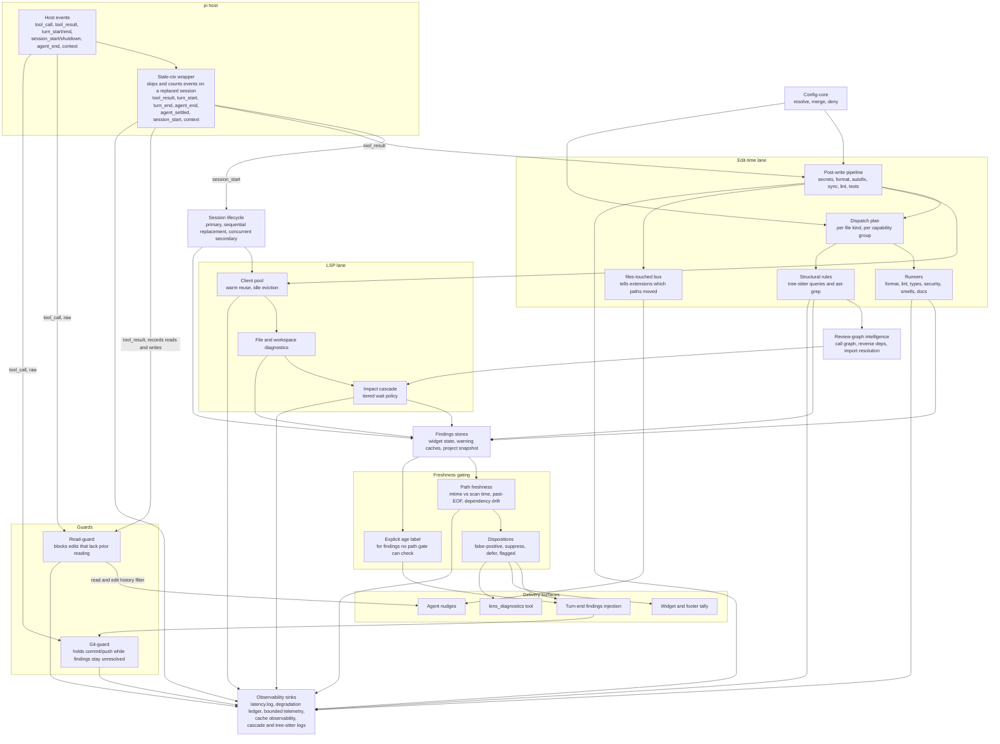

# Architecture

This page maps how pi-lens routes a host event to the findings the agent sees. It is for contributors and curious users; you do not need it to use pi-lens.

Most lifecycle events enter through one wrapper, which drops and counts events
that arrive on a replaced session. `tool_call` registers raw: it delegates
straight to a handler that owns its own total guard. Events fan out into the
edit-time lane and the LSP lane. Both lanes write into the findings stores.
Nothing reaches the agent from those stores until a freshness gate or an
explicit age label clears it.

Architecture-level view, updated when a lane changes. Per-tool inventories live
in [features](features.md) and
[language coverage](language-coverage.md). Today the edit-time lane carries
45+ runner modules over 35+ file kinds, and the LSP lane speaks to 50
language server definitions.

The gating box is an abstraction, not a call order. Freshness covers several
independent mechanisms: path freshness against scan time, past-EOF line checks,
and forward-import dependency drift. Dispositions are one more filter alongside
them, not a second stage every finding walks through. Read the box as "a finding
passes the gates that apply to it", and see `clients/finding-delivery-gate.ts`
for the per-surface contract.
